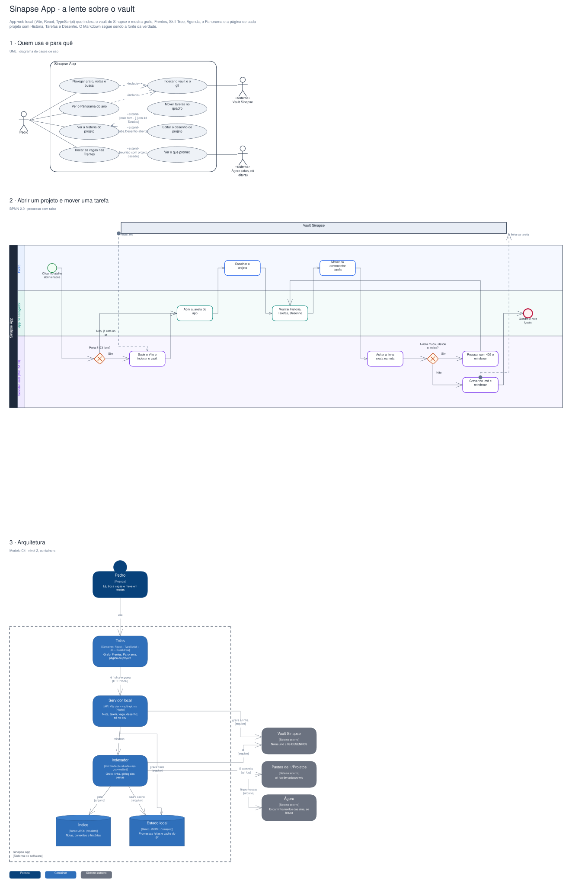

# Arquitetura

Diagramas gerados a partir do Sinapse (o segundo cérebro do Pedro). Cada projeto tem três vistas,
cada uma numa notação padrão:

1. **Quem usa e para quê**: UML, diagrama de casos de uso.
2. **O processo principal**: BPMN 2.0, com raias por quem executa.
3. **A arquitetura**: modelo C4, nível 2 (containers).

## Sinapse App · a lente sobre o vault

App web local (Vite, React, TypeScript) que indexa o vault do Sinapse e mostra grafo, Frentes, Skill Tree, Agenda, o Panorama e a página de cada projeto com História, Tarefas e Desenho. O Markdown segue sendo a fonte da verdade.

Editável: [`sinapse-app.excalidraw`](./sinapse-app.excalidraw), abre em [excalidraw.com](https://excalidraw.com) ou no VS Code com a extensão Excalidraw.

A fonte destes arquivos é o vault do Sinapse (`09-DESENHOS/`); alterações feitas aqui são sobrescritas na próxima publicação.
