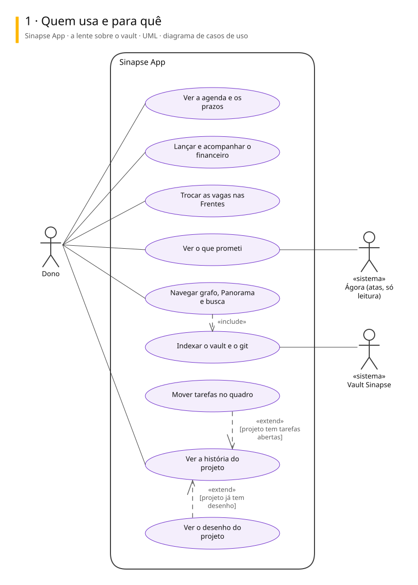
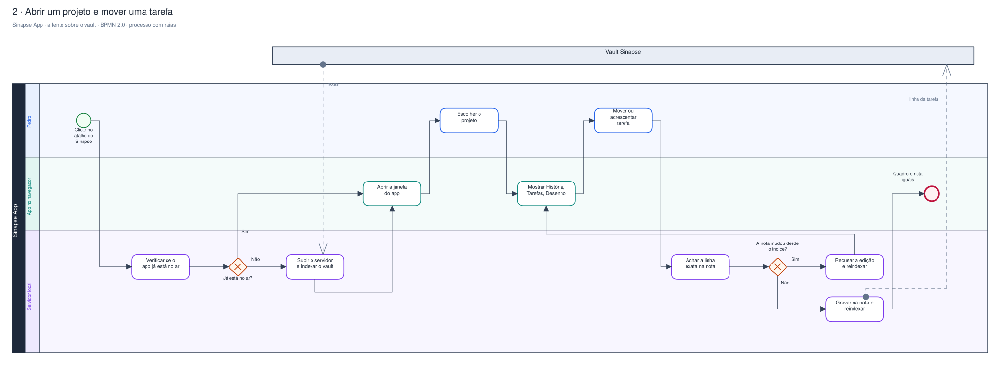
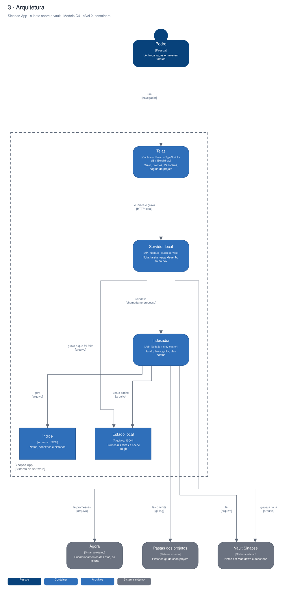

# Arquitetura

Três vistas do sistema, cada uma numa notação padrão.

| Vista | Notação | Responde |
|---|---|---|
| Casos de uso | UML | Quem usa e para quê |
| Processo | BPMN 2.0 | Como o trabalho anda, com uma raia para cada quem executa |
| Arquitetura | C4, nível 2 | De que partes o sistema é feito e com quem conversa |

## Sinapse App · a lente sobre o vault

App web local (Vite, React, TypeScript) que indexa o vault do Sinapse e mostra grafo, Frentes, Agenda, a Métis (finanças, com a projeção Pronoia) e a página de cada projeto. Também gera e publica os diagramas dos projetos. O Markdown é a fonte da verdade.

### Quem usa e para quê

### Abrir um projeto e mover uma tarefa

### Arquitetura

Para editar: [sinapse-app.excalidraw](./sinapse-app.excalidraw), que abre em [excalidraw.com](https://excalidraw.com) ou na extensão Excalidraw do VS Code.

## De onde vêm

Os diagramas são gerados a partir do Sinapse, o vault onde o Pedro organiza notas e projetos. Mudança feita direto aqui some na próxima publicação: o lugar de mudar é a especificação no Sinapse.
